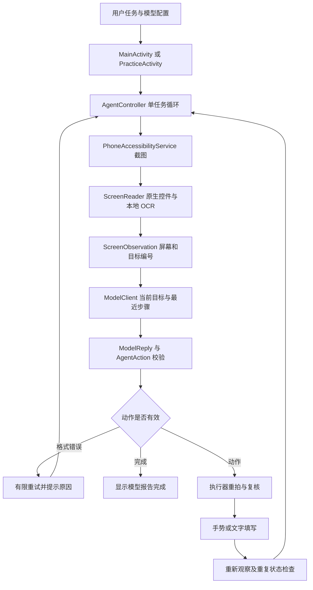

# 0.1.7 当前架构

## 执行路径

当前只有一个进程内任务，`history.takeLast(8)` 保存最近结果。没有具名会话数据库、持久队列、用户澄清问题协议或跨进程任务恢复。

## 模块职责

| 文件 | 当前职责 | 后续扩展点 |
| --- | --- | --- |
| `MainActivity.kt` | 当前任务、配置、调试、日志 UI | 会话导航、编辑步骤、上下文编辑、询问界面 |
| `AgentController.kt` | 单任务状态、截图/模型/执行循环、停止/重试 | 有类型状态机、任务队列、会话仓库、待答问题、恢复 |
| `ModelClient.kt` | 模型请求、最新观察和最近步骤输入、工具 schema | 按会话构造受控上下文、ask_user 类型、能力协商 |
| `ModelReply.kt` / `AgentAction.kt` | 单个结构化调用/动作参数校验 | 提问/确认/完成的分类型决策，不混用手势动作 |
| `PhoneAccessibilityService.kt` | 截图、手势、输入、目标复核和服务连接 | 保持独立执行器，只接受已校验且有效 generation 的动作 |
| `ScreenReader.kt` / `ScreenObservation.kt` | OCR 与原生目标观察，屏幕 ID、匹配 | 新观察替换旧观察，异步结果与 runId/screenId 绑定 |
| `ProgressGuard.kt` | 最近页面循环保护 | 重试策略与升级询问策略协作 |
| `SettingsStore.kt` | 模型配置和密钥加密 | 继续与普通会话数据分离 |
| `PracticeActivity.kt` | 无副作用端到端定位练习 | 添加确定性歧义/多任务/恢复验收场景 |

## 现有关键约定

- 每个有效模型动作只执行一次，然后获取新的截图。格式错误或目标失效不能触发成功动作重放。
- `tap_element` 必须引用当前 `screenId + targetId`；目标由执行器重新截图核对。N 是原生目标，V 是 OCR 文字区域。
- 纯坐标动作用 0..1000 表示整张截图位置。给模型的图片会缩放并添加坐标网格，执行仍映射到原始分辨率。
- `type_text` 优先 ACTION_SET_TEXT，再尝试 Android 13+ 输入连接并验证；数字键盘可用 `tap_key`。
- `scroll down` 是查看下方内容，手指向上滑；手势避开系统栏/IME 区域。
- `generation` 和 Job cancellation 负责停止旧任务。下一阶段新增用户问题和持久上下文也要与同一运行标识绑定。
- App 屏幕边缘绿色手机图标属于系统无障碍快捷开关，可能关闭服务；结束当前任务使用红色“停止任务”。

## 下一阶段的主要架构缺口

当前逻辑把 UI 状态、近期日志和任务执行集中在 Controller。建议先抽取持久化 `SessionRepository`、结构化 `TaskSession/TaskItem`、有类型 `AgentDecision` 和唯一 `ExecutionCoordinator`，再让 UI 订阅状态。让存储、模型上下文与设备执行保持清晰职责，避免把所有功能继续堆进 Activity。

本架构文档是对现有实现的说明和下一步建议，不表示新模块已经完成。
